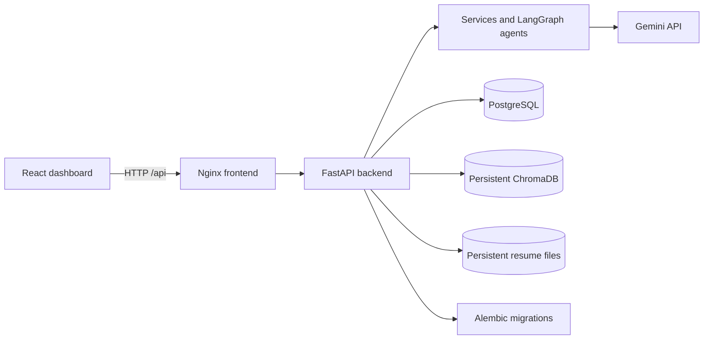

# InterviewIQ

InterviewIQ is an AI-assisted interview preparation workspace. It accepts a resume, extracts its text, analyzes resume and job data, compares the two, retrieves grounded context, and runs a persistent mock interview.

## Features

- PDF and DOCX resume upload with size, MIME, and file-signature validation.
- Resume text extraction and persisted metadata.
- Gemini-backed resume analysis, job analysis, and resume-to-job matching.
- Persistent ChromaDB RAG indexing for resumes and job descriptions.
- LangGraph-based interview planning, question generation, answer evaluation, and completion summaries.
- Persisted interview reports with score aggregation, skill performance, question feedback, recommendations, dashboard summaries, and PDF export.
- PostgreSQL persistence through SQLAlchemy and Alembic.
- React/Vite dashboard with API error states and interview controls.
- Docker Compose deployment with PostgreSQL, backend, frontend, uploads, and ChromaDB volumes.

Authentication and authorization are not implemented. The current deployment is suitable for a trusted development or single-user environment, not an internet-facing multi-user service.

## Architecture



## Technology Stack

- Frontend: React 18, Vite, Axios, React Router, Tailwind CSS tooling.
- Backend: Python 3.12, FastAPI, Pydantic Settings, Uvicorn.
- Persistence: PostgreSQL 17, SQLAlchemy 2, Alembic.
- AI: Google Gemini SDK, LangGraph, Sentence Transformers.
- Retrieval: ChromaDB persistent vector store.
- Documents: PyMuPDF and python-docx.
- Deployment: Docker, Docker Compose, nginx.

## Requirements

For local development: Python 3.12+, Node.js 22+, npm, and PostgreSQL 15+ or Docker Desktop. Gemini analysis, matching, RAG answers, and interview generation require a valid `GEMINI_API_KEY`. Upload and database tests use mocked or local components and do not require live Gemini access.

## Environment Configuration

Copy `backend/.env.example` to `backend/.env` for local backend development. For Compose, create a root `.env` file from the following minimum values:

```dotenv
POSTGRES_PASSWORD=replace-with-a-long-random-password
GEMINI_API_KEY=
GEMINI_MODEL=gemini-3.8-flash
```

Important variables:

| Variable | Default | Purpose |
| --- | --- | --- |
| `DATABASE_URL` | local PostgreSQL URL | SQLAlchemy connection string |
| `POSTGRES_PASSWORD` | required by Compose | PostgreSQL password; never commit it |
| `CORS_ORIGINS` | `['http://localhost:5173']` | JSON list of trusted browser origins |
| `UPLOAD_DIR` | `uploads` | Resume storage directory |
| `MAX_UPLOAD_SIZE_BYTES` | `10485760` | Maximum upload size, 10 MiB |
| `GEMINI_API_KEY` | empty | Server-side provider credential |
| `GEMINI_MODEL` | `gemini-3.8-flash` | Gemini model name |
| `GEMINI_TIMEOUT_SECONDS` | `60` | Provider request timeout |
| `AI_RATE_LIMIT_PER_MINUTE` | `30` | Per-client in-process limit for expensive POST endpoints |
| `RAG_CHROMA_DIR` | `chroma_data` | Persistent ChromaDB directory |
| `RAG_EMBEDDING_MODEL` | `all-MiniLM-L6-v2` | Sentence Transformer model |
| `RAG_TOP_K` | `5` | Retrieval result count |
| `DATABASE_POOL_SIZE` | `5` | SQLAlchemy pool size |
| `DATABASE_MAX_OVERFLOW` | `10` | SQLAlchemy overflow connections |

No API key is sent to the frontend. The frontend calls the backend, which owns provider credentials.

## Docker Startup

From the repository root:

```powershell
Copy-Item .env.example .env
# Edit .env and set POSTGRES_PASSWORD. Set GEMINI_API_KEY for live AI features.
docker compose up --build -d
docker compose ps
```

Open `http://localhost:5173`. The backend Swagger UI is at `http://localhost:8000/docs`; the API health endpoint is `http://localhost:8000/health`.

The Compose stack waits for PostgreSQL health before starting the backend. The backend applies `alembic upgrade head` before Uvicorn starts. Named volumes preserve PostgreSQL data, ChromaDB data, and uploaded files.

Stop the stack with `docker compose down`. Do not add `-v` unless you intend to delete persistent data.

## Local Startup

Backend:

```powershell
cd backend
py -3.12 -m venv .venv
.\.venv\Scripts\Activate.ps1
python -m pip install -r requirements.txt
Copy-Item .env.example .env
alembic upgrade head
python -m uvicorn app.main:app --reload --port 8000
```

Frontend:

```powershell
cd frontend
npm install
npm run dev
```

## Database Migrations

```powershell
cd backend
alembic upgrade head
alembic current
alembic downgrade -1
```

The schema includes resumes, resume analyses, job descriptions, job matches, interview sessions, interview questions, candidate answers, answer evaluations, and persisted interview reports. Resume files and vectors are filesystem-backed and are not stored in PostgreSQL.

## API Endpoints

| Method | Endpoint | Purpose |
| --- | --- | --- |
| `GET` | `/health` | Service and database health |
| `POST` | `/api/v1/resumes/upload` | Upload and extract a PDF/DOCX resume |
| `GET` | `/api/v1/resumes/{resume_id}` | Retrieve resume metadata and extracted text |
| `POST` | `/api/v1/resumes/{resume_id}/analyze` | Analyze a stored resume with Gemini |
| `POST` | `/api/v1/jobs/analyze` | Analyze a job description |
| `GET` | `/api/v1/jobs/{job_id}` | Retrieve a job analysis |
| `POST` | `/api/v1/jobs/{job_id}/match/{resume_id}` | Match resume evidence to a job |
| `POST` | `/api/v1/rag/index/resume/{resume_id}` | Index a resume when its content changed |
| `POST` | `/api/v1/rag/index/job/{job_id}` | Index a job description |
| `POST` | `/api/v1/rag/reindex/resume/{resume_id}` | Force resume re-indexing |
| `POST` | `/api/v1/rag/query` | Ask a grounded question |
| `POST` | `/api/v1/interviews/start` | Start a persistent mock interview |
| `GET` | `/api/v1/interviews/{interview_id}` | Retrieve interview state |
| `POST` | `/api/v1/interviews/{interview_id}/answer` | Submit and evaluate an answer |
| `POST` | `/api/v1/interviews/{interview_id}/next-question` | Retrieve the current question |
| `POST` | `/api/v1/interviews/{interview_id}/complete` | Complete an interview and generate its summary |
| `GET` | `/api/v1/reports/{report_id}` | Retrieve a persisted completed-interview report |
| `GET` | `/api/v1/interviews/{interview_id}/report` | Retrieve the report for a completed interview |
| `GET` | `/api/v1/reports` | List reports with pagination and optional resume filter |
| `GET` | `/api/v1/dashboard/summary` | Retrieve verified progress metrics and trends |
| `GET` | `/api/v1/reports/{report_id}/pdf` | Download a generated report PDF |

Example upload:

```powershell
curl.exe -F "file=@resume.pdf" http://localhost:8000/api/v1/resumes/upload
```

Example job analysis:

```powershell
curl.exe -X POST http://localhost:8000/api/v1/jobs/analyze `
  -H "Content-Type: application/json" `
  -d '{"description":"Backend engineer with Python, FastAPI, and PostgreSQL experience."}'
```

A successful upload returns an object containing `id`, `original_filename`, `file_type`, `extracted_text`, and timestamps. It never returns the stored filesystem path. A job analysis returns `id`, `description`, `job_title`, `summary`, skills, responsibilities, and timestamps.

## Testing

Backend tests:

```powershell
cd backend
.\.venv\Scripts\Activate.ps1
python -m pytest -q
```

Frontend production build:

```powershell
cd frontend
npm run build
```

The test suite covers health, database migrations, resume upload and extraction, mocked AI analysis and matching, RAG behavior, and interview workflows. Live Gemini calls are not part of the automated suite and require explicit provider credentials. Browser component tests and live Docker smoke tests are not currently present.

## Security and Reliability Notes

- Uploads use generated UUID filenames and are stored outside the public frontend tree.
- Uploads are limited to 10 MiB by default and checked against PDF/DOCX signatures.
- Pydantic validates request lengths and positive identifiers.
- SQLAlchemy parameterizes database access; no raw user SQL is used.
- Provider errors return sanitized API messages rather than stack traces.
- CORS is restricted to configured origins and credentials are disabled until authentication exists.
- Expensive POST routes have a per-client in-process rate limit. It is not a distributed limiter and should be replaced with Redis or an API gateway for multiple replicas.
- Gemini timeout and SQLAlchemy connection pooling are configurable.
- RAG indexing uses content hashes and persistent storage.
- Authentication, authorization, user ownership, encrypted file storage, malware scanning, distributed rate limiting, and audit logging remain deployment requirements for a public multi-user release.

## Audit Summary

Completed: Phases 1-5 core foundation, resume persistence and extraction, Gemini analysis/matching, persistent RAG indexing/querying, LangGraph interview workflow, API validation, database migrations, focused backend tests, frontend build, and Docker Compose configuration.

Incomplete or unverified: authentication and authorization are absent; no live Gemini tests were run; Docker service startup was not run in this environment; browser E2E tests are absent. Report scores and skill metrics are derived only from stored evaluations; no fake dashboard values are generated.

Known risks: the in-memory rate limiter resets on process restart and is per worker; Chroma and uploaded files require reliable volume backups; multi-user ownership cannot be enforced without authentication; AI output quality depends on provider availability and model behavior.

## Troubleshooting

- If Compose refuses to interpolate variables, create a root `.env` and set `POSTGRES_PASSWORD`.
- If the backend cannot connect locally, verify `DATABASE_URL`, PostgreSQL availability, and that migrations were applied.
- If AI endpoints return `503`, set `GEMINI_API_KEY` in the backend environment and verify the configured model.
- If RAG startup is slow, the embedding model may be downloading on first use.
- If a stale Docker database is causing migration issues, inspect `docker compose logs postgres backend`; deleting the named volume destroys data.

## GitHub Readiness

Secrets, virtual environments, caches, frontend dependencies, and build output are ignored. Review `git diff --check` and run the test/build commands before committing. Suggested commits are: `harden uploads and API limits`, `add production compose deployment`, and `document Phase 7 validation`. Do not commit `.env`, uploaded files, Chroma data, or database volumes.
