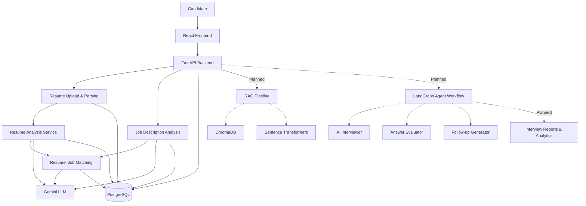

# InterviewIQ – AI-Powered Interview Preparation Platform

An intelligent interview preparation platform that helps candidates prepare for job interviews through resume analysis, job description matching, personalized interview insights, and AI-powered mock interviews.

InterviewIQ aims to combine **Generative AI, Retrieval-Augmented Generation (RAG), and AI Agents** to deliver a personalized interview preparation experience.

---

## 🚀 Project Overview

Preparing for technical interviews can be challenging. Candidates often struggle to identify skill gaps, understand job requirements, prepare relevant questions, and evaluate their interview performance.

InterviewIQ addresses these challenges by analyzing a candidate's resume and target job description to provide personalized preparation support.

The platform is designed to evolve from an AI-powered resume analysis tool into a complete intelligent interview preparation system.

## ✨ Key Features

### Implemented

- **Resume Upload:** Upload PDF and DOCX resumes.
- **Resume Text Extraction:** Extract resume content for further processing.
- **AI Resume Analysis:** Analyze technical skills, experience, strengths, and improvement areas using Gemini.
- **Job Description Analysis:** Extract job requirements, skills, and qualifications.
- **Resume–Job Matching:** Compare a resume against a job description and generate a compatibility score.
- **Personalized Recommendations:** Identify missing skills and areas for improvement.
- **Persistent Storage:** Store resumes, analysis results, job descriptions, and matching records in PostgreSQL.

### Planned

- **RAG-Based Resume Assistant:** Ask questions about uploaded resumes and job descriptions using retrieved context.
- **AI Mock Interviews:** Conduct interactive interviews based on the candidate's resume and target role.
- **Multi-Agent Interview Workflow:** Use specialized AI agents for planning, question generation, interviewing, evaluation, and follow-up questions.
- **Answer Evaluation:** Evaluate answers based on correctness, relevance, completeness, clarity, and problem-solving ability.
- **Interview Reports:** Generate detailed performance reports with scores and improvement recommendations.
- **Analytics Dashboard:** Track interview history, performance trends, and skill development.

## 🏗️ System Architecture



## 🛠️ Technology Stack

| Category | Technologies |
|---|---|
| Frontend | React, Vite, Tailwind CSS |
| Backend | Python, FastAPI |
| Database | PostgreSQL |
| ORM | SQLAlchemy |
| Migrations | Alembic |
| LLM | Google Gemini API |
| Resume Processing | PyMuPDF, python-docx |
| API Testing | Pytest |
| RAG – Planned | ChromaDB, Sentence Transformers |
| AI Orchestration – Planned | LangGraph, LangChain |
| Containerization | Docker, Docker Compose |

## 📂 Project Structure

```text
InterviewIQ/
│
├── backend/
│   ├── app/
│   │   ├── agents/
│   │   ├── database/
│   │   ├── models/
│   │   ├── rag/
│   │   ├── routers/
│   │   ├── schemas/
│   │   ├── services/
│   │   ├── config.py
│   │   └── main.py
│   │
│   ├── alembic/
│   ├── tests/
│   ├── uploads/
│   ├── requirements.txt
│   └── .env
│
├── frontend/
│   ├── src/
│   │   ├── components/
│   │   ├── pages/
│   │   ├── services/
│   │   └── App.jsx
│   │
│   ├── package.json
│   └── vite.config.js
│
├── docker-compose.yml
├── .gitignore
└── README.md
```

*Note: The structure above represents the intended application organization. Update it if your actual repository uses different folder names.*

## ⚙️ Getting Started

### Prerequisites

Make sure you have installed:

- Python 3.12
- Node.js and npm
- PostgreSQL (or Docker Desktop)
- Git
- Google Gemini API key

### 1. Clone the Repository

```bash
git clone https://github.com/praveen0815/InterviewIQ.git

cd InterviewIQ
```

### 2. Backend Setup

Open a terminal and navigate to the backend directory.

```bash
cd backend
```

Create a virtual environment:

```bash
py -3.12 -m venv .venv
```

Activate it:

```powershell
.venv\Scripts\Activate.ps1
```

Install dependencies:

```bash
pip install -r requirements.txt
```

### 3. Environment Configuration

Create a `.env` file in the backend directory.

```
Replace the placeholder values with your local configuration.

**Important:** Never commit your `.env` file or expose your Gemini API key in frontend code.

### 4. Database Migration

Run the database migrations:

```bash
alembic upgrade head
```

### 5. Start the Backend

```bash
uvicorn app.main:app --reload
```

Backend:

`http://localhost:8000`

API Documentation:

`http://localhost:8000/docs`

Health Check:

`http://localhost:8000/health`

### 6. Frontend Setup

Open another terminal:

```bash
cd frontend
```

Install dependencies:

```bash
npm install
```

Start the development server:

```bash
npm run dev
```

Frontend:

`http://localhost:5173`

## 🔗 API Endpoints

### Resume Management

| Method | Endpoint | Description |
|---|---|---|
| POST | `/api/v1/resumes/upload` | Upload a resume |
| GET | `/api/v1/resumes/{resume_id}` | Retrieve resume details |
| POST | `/api/v1/resumes/{resume_id}/analyze` | Analyze an uploaded resume |

### Job Description & Matching

| Method | Endpoint | Description |
|---|---|---|
| POST | `/api/v1/jobs/analyze` | Analyze a job description |
| POST | `/api/v1/jobs/{job_id}/match/{resume_id}` | Match resume with a job |

### Health

| Method | Endpoint | Description |
|---|---|---|
| GET | `/health` | Check backend health |

### Planned API Capabilities

The following APIs are part of the future development roadmap:

- RAG-based resume and job knowledge queries.
- Interview session creation and management.
- Candidate answer submission and evaluation.
- Interview completion and report generation.
- Dashboard analytics.

## 🧠 AI Workflow

The planned end-to-end InterviewIQ workflow:

1. Candidate uploads a resume.
2. The system extracts resume content.
3. Gemini analyzes skills, experience, and qualifications.
4. Candidate submits a target job description.
5. The system analyzes job requirements.
6. Resume and job requirements are compared.
7. RAG retrieves relevant resume and job information.
8. AI agents generate personalized interview questions.
9. The candidate participates in a mock interview.
10. AI evaluates answers and generates feedback.
11. The platform creates an interview performance report.

## 🧪 Testing

Backend tests:

```bash
pytest -v
```

Frontend production build:

```bash
npm run build
```

AI integration tests should distinguish mocked LLM responses from real Gemini API requests.

## 🔐 Security Considerations

- Keep API keys and database credentials in environment variables.
- Validate uploaded file types and sizes.
- Use safe, generated filenames for uploaded resumes.
- Avoid exposing internal server errors or sensitive file paths.
- Restrict CORS to trusted frontend origins in production.
- Never expose LLM credentials to the browser.
- Add authentication and authorization before handling real candidate accounts and private resumes.

## 🎯 Project Objectives

- Build a practical AI-powered interview preparation platform.
- Apply Generative AI to resume and job description understanding.
- Implement RAG for context-aware responses.
- Develop multi-agent workflows using LangGraph.
- Build reliable backend APIs using FastAPI.
- Integrate AI capabilities with a modern React frontend.
- Generate actionable interview feedback and performance insights.

## 👨‍💻 Developer

**Praveenkumar R.**
